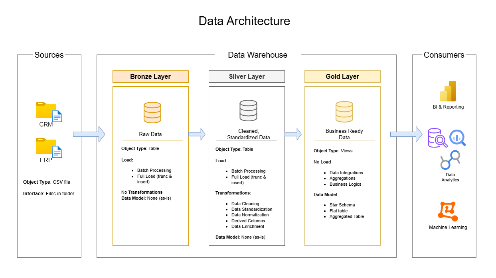

# SQL Data Warehouse Project
 
A complete, end-to-end data warehousing and analytics project built with SQL Server, demonstrating the design and development of a modern data warehouse using the **Medallion Architecture** (Bronze, Silver, Gold layers).
 
This project covers the full data lifecycle — from raw data ingestion through transformation to business-ready analytical reporting.
 
## Data Architecture
 

 
The warehouse follows a three-layer Medallion Architecture:
 
- **Bronze Layer** — Raw, unprocessed data ingested as-is from source systems (CRM and ERP CSV files) into SQL Server. No transformations are applied; this layer preserves the original data for traceability.
- **Silver Layer** — Cleansed, standardized, and normalized data. This layer handles data quality issues such as duplicates, inconsistent formats, and missing values, preparing the data for reliable analysis.
- **Gold Layer** — Business-ready data modeled into a star schema (fact and dimension tables), optimized for analytical queries and reporting.
## Project Objective
 
Build a modern data warehouse using SQL Server to consolidate sales data from two source systems (CRM and ERP), enabling clean, structured, and reliable data for analytical reporting and business decision-making.
 
**Key areas covered:**
- Data architecture design using the Medallion Architecture
- ETL pipelines for extracting, transforming, and loading data across layers
- Data modeling with fact and dimension tables
- SQL-based analytics and reporting on customer behavior, product performance, and sales trends
## Tools Used
 
| Tool | Purpose |
|---|---|
| SQL Server | Database engine for hosting the warehouse |
| SQL Server Management Studio (SSMS) | SQL development and database administration |
| Draw.io | Designing the data architecture and ETL flow diagrams |
| Git & GitHub | Version control |
 
## 📂 Repository Structure
 
```text
sql-data-warehouse-project/
├── datasets/                          # Raw source CSV files from ERP and CRM systems
│   ├── source_crm/
│   │   ├── cust_info.csv
│   │   ├── prd_info.csv
│   │   └── sales_details.csv
│   └── source_erp/
│       ├── CUST_AZ12.csv
│       ├── LOC_A101.csv
│       └── PX_CAT_G1V2.csv
├── docs/                              # Architecture diagrams, data models, and documentation
│   ├── data_architecture.png
│   ├── data_layers.png
│   ├── data_flow.png
│   ├── data_integration.png
│   ├── data_model.png
│   ├── data_catalog.md
│   └── naming_conventions.md
├── scripts/                           # T-SQL scripts organized by Medallion Architecture layer
│   ├── init_database.sql              # Initializes DataWarehouse DB & bronze/silver/gold schemas
│   ├── bronze/
│   │   ├── ddl_bronze.sql
│   │   └── proc_load_bronze.sql
│   ├── silver/
│   │   ├── ddl_silver.sql
│   │   └── proc_load_silver.sql
│   └── gold/
│       └── ddl_gold.sql
├── tests/                             # SQL data quality and integrity validation checks
│   ├── quality_checks_silver.sql
│   └── quality_checks_gold.sql
└── README.md
```
 
## Key Outcomes
 
- Designed and implemented a layered (Bronze/Silver/Gold) data warehouse architecture in SQL Server
- Built ETL scripts to ingest, clean, and transform CRM and ERP source data
- Modeled business-ready fact and dimension tables for analytical reporting
- Wrote SQL-based reports and queries to surface insights on customer behavior, product performance, and sales trends
## About This Project
 
This project was built as a personal portfolio project to demonstrate practical, end-to-end data engineering and SQL skills — covering data architecture, ETL development, data modeling, and analytics.
 
